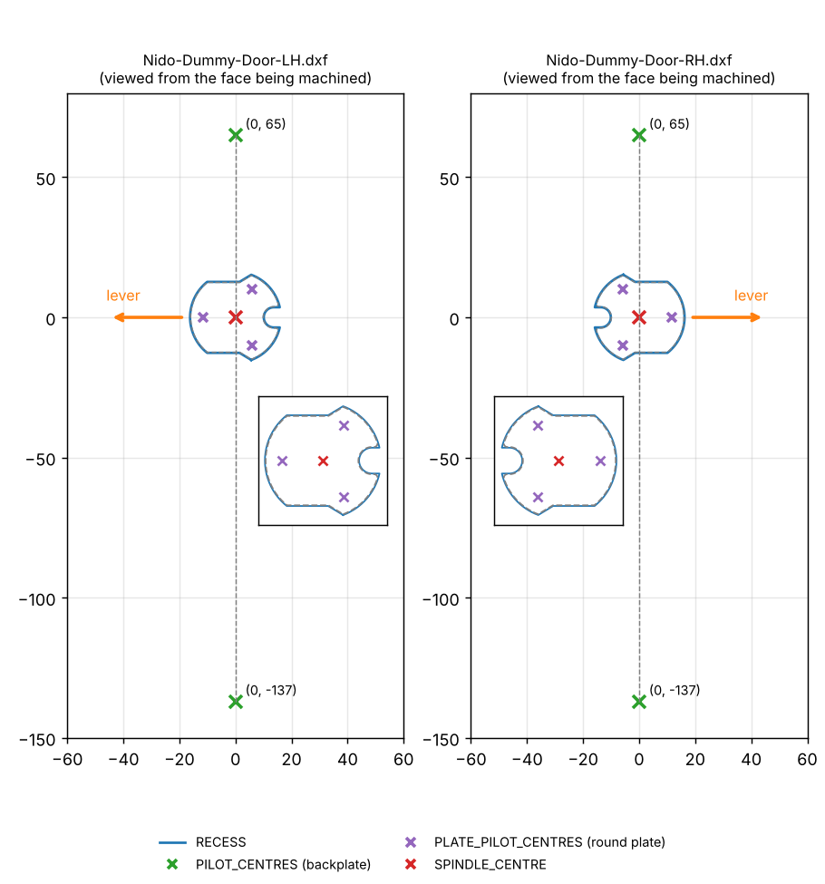
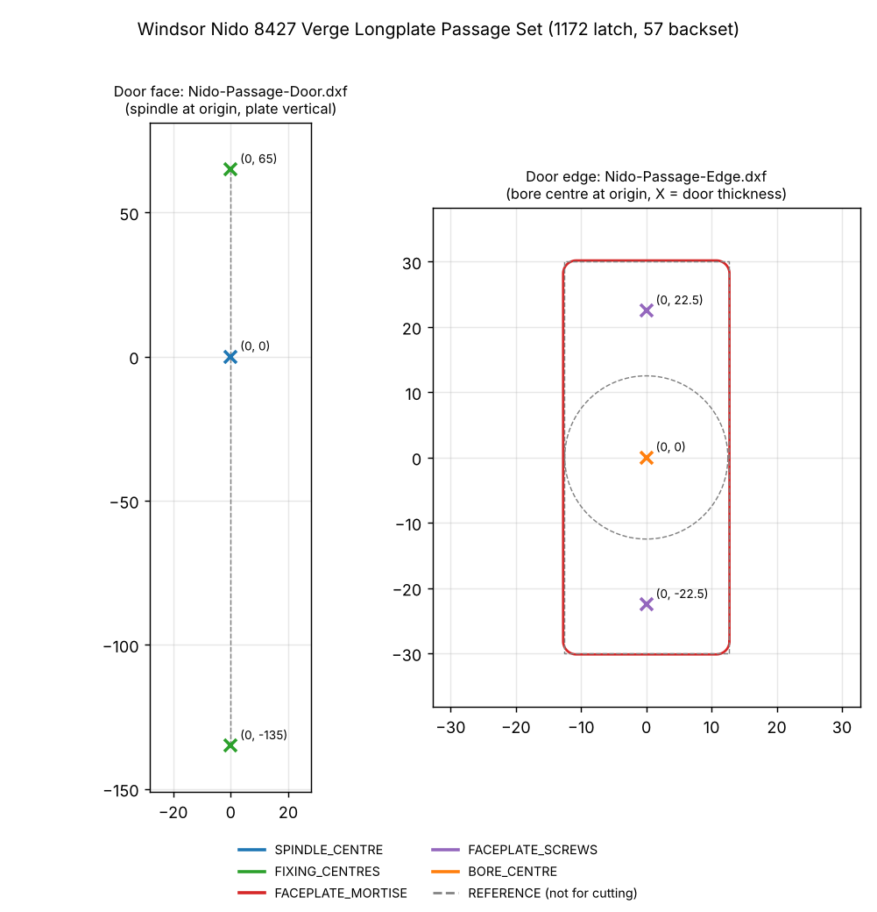

# Windsor Nido (Verge Longplate)

All files in mm. Face layouts: spindle centre at the origin, longplate vertical (+Y up),
viewed from the face being machined. Pilot/hole positions are POINTs (Maestro imports them).

| Set | Description | Folder | Files |
|---|---|---|---|
| **8423** | Verge Longplate **Dummy** Set | [`Dummy/`](Dummy/) | `Nido-Dummy-Door-LH.dxf`, `Nido-Dummy-Door-RH.dxf` (recess + pilots), `Nido-Dummy-Plate.dxf` (round plate on its own), preview `Nido-Dummy-Door-LH-RH.png` |
| **8427** | Verge Longplate **Passage** Set (1172 latch, 57 backset) | [`Passage/`](Passage/) | `Nido-Passage-Door.dxf` (face), `Nido-Passage-Edge.dxf` (edge), preview `Nido-Passage-8427.png` |

## 8423 Dummy
- `RECESS`: round spindle plate recess, 0.2 mm clearance, cut with the tool inside (Ø3 bit or smaller).
- `PILOT_CENTRES`: backplate screws at (0, +65) and (0, −135), 200 c-c (checked on a test door).
- `PLATE_PILOT_CENTRES`: round plate's three screws, 23.1 PCD.
- LH = hinges on the left, lever points left; the notch points away from the lever.

## 8427 Passage
- Face: `SPINDLE_CENTRE` through-hole at (0, 0); `FIXING_CENTRES` bolt-through holes at (0, +65) and (0, −135). One file for LH and RH.
- Edge: `FACEPLATE_MORTISE` 25.50 × 60.34 R2 (faceplate 25.30 × 60.14 + 0.1); `FACEPLATE_SCREWS` (0, ±22.5); `BORE_CENTRE` for the Ø25 bore (Windsor spec, narrower than the 25.30 faceplate), ≥ 80 deep (77 case).
- Latch: Windsor 1172 heavy sprung tubular latch, 57 mm backset.

