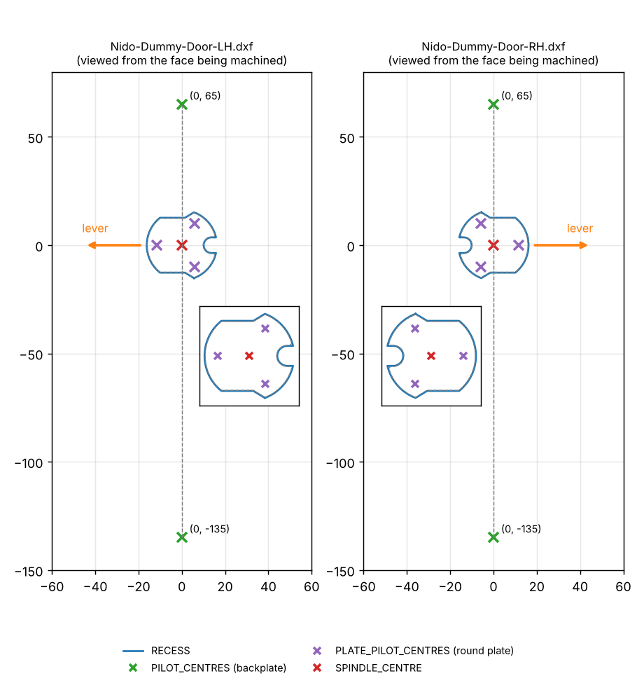
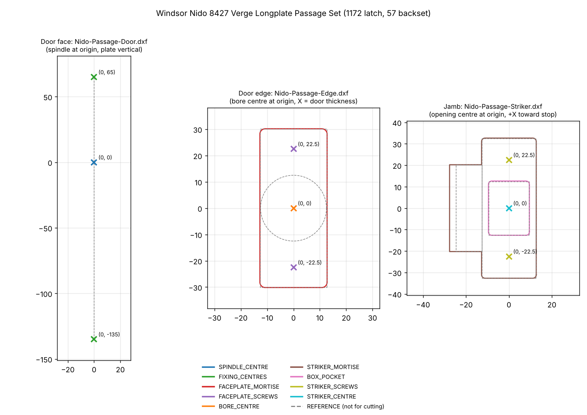

# Windsor Nido (Verge Longplate)

All files in mm. Face layouts: spindle centre at the origin, longplate vertical (+Y up),
viewed from the face being machined. Pilot/hole positions are POINTs (Maestro imports them).

| Set | Description | Status | Folder | Files |
|---|---|---|---|---|
| **8423** | Verge Longplate **Dummy** Set | ✅ **TESTED** | [`8423-Dummy/`](8423-Dummy/) | `Nido-Dummy-Door-LH.dxf`, `Nido-Dummy-Door-RH.dxf` (recess + pilots), `Nido-Dummy-Plate.dxf` (round plate on its own), preview `Nido-Dummy-Door-LH-RH.png` |
| **8427** | Verge Longplate **Passage** Set (1172 latch, 57 backset) | ⚠️ **UNTESTED** | [`8427-Passage/`](8427-Passage/) | `Nido-Passage-Door.dxf` (face), `Nido-Passage-Edge.dxf` (edge), `Nido-Passage-Striker.dxf` (jamb), preview `Nido-Passage-8427.png` |

## 8423 Dummy: TESTED
- `RECESS`: round spindle plate recess, 0.2 mm clearance, cut with the tool inside (Ø3 bit or smaller).
- `PILOT_CENTRES`: backplate screws at (0, +65) and (0, −135), 200 c-c (checked on a test door).
- `PLATE_PILOT_CENTRES`: round plate's three screws, 23.1 PCD.
- LH = hinges on the left, lever points left; the notch points away from the lever.

## 8427 Passage: UNTESTED
- Face: `SPINDLE_CENTRE` through-hole at (0, 0); `FIXING_CENTRES` bolt-through holes at (0, +65) and (0, −135). One file for LH and RH.
- Edge: `FACEPLATE_MORTISE` 25.50 × 60.34 R2 (faceplate 25.30 × 60.14 + 0.1); `FACEPLATE_SCREWS` (0, ±22.5); `BORE_CENTRE` for the Ø25 bore (Windsor spec, narrower than the 25.30 faceplate), ≥ 80 deep (77 case).
- Latch: Windsor 1172 heavy sprung tubular latch, 57 mm backset.
- Jamb (striker): `STRIKER_MORTISE` T-shape: 25.46 × 65.34 R1.6 (plate 25.26 × 65.14 + 0.1) plus a 40.48 wide lip slot running 15 past the plate, off the jamb edge; `BOX_POCKET` 19.08 × 25.32 R1.6 (dust box 18.68 × 24.92 + 0.2); `STRIKER_SCREWS` (0, ±22.5); `STRIKER_CENTRE` at the latch height (Y = 0). Line the opening centre up half the door thickness off the stop; the lip slot points away from the stop (mirror in X for the other hand). Square the plate's corners by hand.

